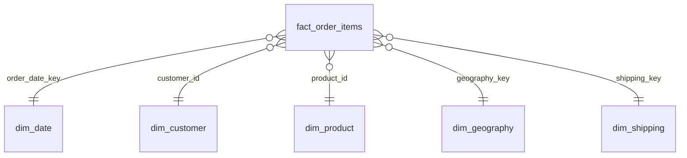

# Handoff Plan — Clean → Model + Analyze

**From:** Samir (Clean) · **To:** Samriti (Model + Analyze) · cc Rebal (Power BI)

This is a **suggested** plan. Samriti owns the modelling and SQL decisions; change anything that doesn't fit.
Background on the data: [cleaning report](../Clean/cleaning_report.md) · column list: [cleaning rules](../Clean/cleaning_rules.md#output-schema--order_items_clean-42-columns).

---

## 1. What you receive

| File | What |
|---|---|
| `Data/Cleaned/order_items_clean.parquet` (+ `.csv`) | One flat table, 180,519 rows × 42 columns, one row per order item |
| `Data/Cleaned/control_totals.json` | Official row counts and totals to reconcile against |
| `Clean/data_dictionary.md` | Every column: type, meaning, source |

**Timing:** a **v0** file (PII dropped, dates parsed, snake_case names) comes first so you can start the model. The final file has the same column names, so your SQL won't break.

### Status: final file ready (42 columns)

All 16 cleaning rules are done and all 24 validation checks pass. Column names are the same as in v0, plus `shipping_delay_days` and the three `is_*` flags, so SQL written against v0 still works.

- Countries are English, zips are 5-character text, money is rounded to 2 dp.
- Use `category_id` as the key; names are now unique too (`Electronics (Footwear)` / `Electronics (Outdoors)`).
- Reconcile against the **current** `control_totals.json`. Rounding moved totals by under $1, so v0 totals are out of date.

## 2. Five things to know before writing SQL

1. **Profit and sales are item-level.** `profit`, `sales` and `net_sales` are per order item. Summing them is correct; averaging per order needs a `GROUP BY order_id` first.
2. **Two geographies.** `customer_*` and `store_*` columns are the **store** (US/PR only). `market`, `order_region`, `order_country`… are the **delivery destination**. Use destination for fulfillment questions.
3. **Last 4 months are thin.** Rows with `is_low_coverage_period = true` (Oct 2017 – Jan 2018) cover only 2 markets and 31 products. Exclude them from trend and MoM/YoY analysis, or you'll show a false 60% drop.
4. **The SLA is a fixed rule per shipping mode.** Same Day = 0 days, First = 1, Second = 2, Standard = 4. "SLA realism" means comparing real days against this rule. Early signal: **First Class is late on 100% of items** (always +1 day), Second Class on 80%, Standard Class on 40% (see `Clean/02_cleaning_decisions.ipynb`).
5. **Cancelled and fraud orders are still in the table.** Filter them deliberately (see §4).

## 3. Suggested star schema



| Table | Grain | Columns from the clean table | Notes |
|---|---|---|---|
| `fact_order_items` | 1 row per order item (180,519) | `order_item_id`, `order_id` (degenerate), FKs, `quantity`, `sales`, `discount_amount`, `discount_rate`, `net_sales`, `profit`, `profit_ratio`, `days_shipping_real`, `shipping_delay_days`, `delivery_status`, `order_status`, `payment_type`, `shipping_date`, all `is_*` flags | `order_status` / `payment_type` could also be a small junk dimension |
| `dim_date` | 1 row per calendar day, 2015-01-01 → 2018-02-06 | Generated, not taken from the data | `date_key` (yyyymmdd), year, quarter, month, month name, week, weekday, `is_low_coverage_period` |
| `dim_customer` | 1 row per customer (20,652) | `customer_id`, `customer_segment`, `customer_city`, `customer_state`, `customer_zipcode`, `customer_country`, `store_latitude`, `store_longitude` | Verified: each customer has exactly one segment, city and lat/long |
| `dim_product` | 1 row per product (118) | `product_id`, `product_name`, `product_price`, `category_id`, `category_name`, `department_id`, `department_name` | Verified: each product has one price and one category; each category one department |
| `dim_geography` | 1 row per destination (3,772 combinations) | `market`, `order_region`, `order_country`, `order_state`, `order_city` | Needs a surrogate `geography_key` |
| `dim_shipping` | 1 row per shipping mode (4) | `shipping_mode`, `days_shipping_scheduled` | This table **is** the SLA rule |

**Model checks:** fact row count = 180,519; every FK matches a dimension row; fact totals = `control_totals.json`.

**SQL engine suggestion: DuckDB.** It reads the Parquet file directly, needs no server (fits the "everything in GitHub" decision), and the `.sql` files live in the repo. Power BI can read the exported tables as Parquet or CSV.

## 4. Proposed default filters for KPIs (to agree as a team)

| KPI family | Default filter | Why |
|---|---|---|
| Revenue, profit, margin, discount | Exclude `is_canceled` and `is_suspected_fraud` | That revenue was never realised |
| On-time %, late %, delay days | Exclude `is_canceled` and `is_suspected_fraud` | A cancelled order has no real delivery |
| Cancellation % / fraud % | All rows | These rows are the numerator |
| Trends (MoM, YoY, rolling) | Also exclude `is_low_coverage_period` | Not comparable months |

**Write every filter into the SQL file name or header** (e.g. `-- filter: excludes canceled + fraud`), so Rebal's DAX uses the same rule.

## 5. Suggested KPI definitions

| KPI | Definition |
|---|---|
| Net revenue | `SUM(net_sales)` |
| Profit | `SUM(profit)` |
| Profit margin | `SUM(profit) / SUM(net_sales)` |
| Discount % | `SUM(discount_amount) / SUM(sales)` |
| Late % | `AVG(is_late)` (≈ 57% with default filters) |
| On-time % | share of `delivery_status` in (`Shipping on time`, `Advance shipping`) |
| Avg delay | `AVG(shipping_delay_days)` |
| Revenue at risk | `SUM(net_sales) WHERE is_late` |
| Cancellation % | `AVG(is_canceled OR is_suspected_fraud)` over all rows |

## 6. Suggested SQL analyses (17, mapped to the six questions)

| # | Question | Analysis | SQL skills shown |
|---|---|---|---|
| 1 | 01 Fulfillment | Late % by market → region → country (drill-down) | `GROUP BY ROLLUP` |
| 2 | 01 Fulfillment | Late % by shipping mode × market heatmap | Pivot / conditional aggregation |
| 3 | 01 Fulfillment | Worst 10 country × category combinations (min. volume) | CTE + `HAVING` + `RANK()` |
| 4 | 02 SLA realism | Real vs scheduled days distribution per shipping mode | `PERCENTILE_CONT` |
| 5 | 02 SLA realism | "Realistic SLA": the day count that 90% of orders actually meet, per mode | Percentiles vs fixed rule |
| 6 | 02 SLA realism | Delay days trend over time per mode | Window `AVG() OVER` |
| 7 | 03 Profitability | Profit and margin by market, category, department | Aggregation |
| 8 | 03 Profitability | Loss-making products: total loss and share of revenue | `CASE` + filters |
| 9 | 03 Profitability | Discount band vs margin (does discounting destroy profit?) | `CASE` banding |
| 10 | 03 Profitability | Revenue and profit tied to late deliveries | Conditional sums |
| 11 | 04 Product | Product quadrant: volume × margin (stars / cash cows / problem items) | `NTILE()` |
| 12 | 04 Product | Top / bottom 10 products by profit per market | `ROW_NUMBER() OVER (PARTITION BY market)` |
| 13 | 04 Product | Pareto: how many products make 80% of revenue | Running `SUM() OVER` |
| 14 | 05 Demand | Monthly revenue + MoM % per category | `LAG()` |
| 15 | 05 Demand | YoY growth and 3-month rolling average | `LAG(12)`, window frames |
| 16 | 05 Demand | Seasonality index by month of year | Aggregation over years |
| 17 | 06 Priority | **Priority score** per market × category: late % × revenue at risk × volume, ranked | Multi-CTE + normalisation + `RANK()` |

Analysis 17 feeds Rebal's **Operations Priority** page directly. Agree on the formula early.

## 7. Suggested order of work

1. Load the v0 Parquet into DuckDB; check the row count and totals against `control_totals.json`.
2. Build `dim_shipping`, `dim_product`, `dim_customer` (simple, verified 1:1).
3. Build `dim_geography` (surrogate key) and generated `dim_date`.
4. Build `fact_order_items`; run the FK and reconciliation checks.
5. Export the star schema tables for Rebal → `Model/output/`.
6. Analyses 1–10 (fulfillment, SLA, profitability), then 11–17.
7. Write findings in the format: **finding → $ impact → recommendation** (this goes in the README's Key Findings).

## 8. Suggested folder layout

```
Model/
  handoff_plan.md      ← this file
  sql/                 01_dim_date.sql … 06_fact_order_items.sql
  checks/              reconciliation.sql
  output/              exported star schema tables for Power BI
Analyze/
  sql/                 q01_late_by_market.sql …
  notebooks/           EDA
  findings.md
```

## 9. Questions to settle at the next sync

- [ ] Agree on the default KPI filters (§4)
- [ ] Trend charts: stop at Sep 2017, or show the low-coverage months with a warning?
- [ ] Priority score formula (analysis 17)
- [ ] SQL engine: DuckDB or another choice
- [ ] Format Rebal wants: Parquet or CSV for the star schema tables
