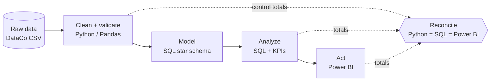
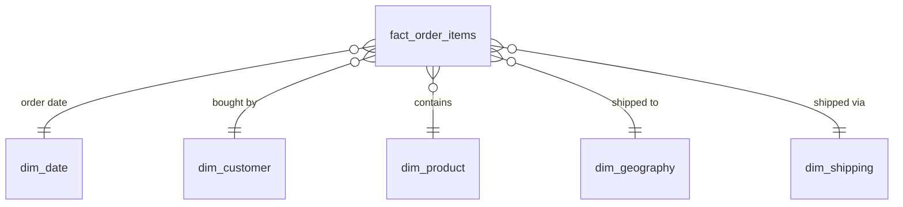

<div align="center">

# SupplyChainIQ

### Fulfillment, Demand & Profitability Intelligence

**An end-to-end analytics product that turns 180K supply-chain transactions into a prioritized action list for operations managers.**


</div>

<!-- TODO (step 7): replace this comment with a dashboard screenshot or GIF, e.g.
<p align="center"></p>
-->

---

## The Question

> ### *"Where are we losing time and money — and what should operations do first?"*

Most supply-chain dashboards show *what* happened. SupplyChainIQ is built to answer **what to do next**: which markets, products and shipping modes are late, how much revenue and profit that puts at risk, and where management should look first.

## At a Glance

| | |
|---|---|
| **180,519** | order-item transactions across 5 global markets |
| **6** | business questions, each tied to a decision |
| **5** | pipeline stages, from raw CSV to recommendation |
| **6** | Power BI pages, from executive overview to operations priority |
| **3** | analysts, working as a small analytics team with PRs and reviews |

## Key Findings

> 🚧 **In progress.** Findings will be published here as each analysis stage is completed.

<!-- Template for each finding:
### 1. <Headline finding with a number>
**What we found:** ...
**Why it matters:** $X of revenue / X% of orders affected
**Recommendation:** ...
-->

## Six Questions, Six Decisions

| # | Area | Question | How we measure it |
|---|---|---|---|
| 01 | **Fulfillment** | Where are late deliveries concentrated? | On-time %, Late %, Cancellation % |
| 02 | **SLA realism** | Are promised shipping times achievable? | Actual − scheduled shipping days |
| 03 | **Profitability** | Where is margin being destroyed? | Revenue, profit, margin, discount |
| 04 | **Product performance** | What sells — and what actually makes money? | Volume × profitability segments |
| 05 | **Demand trends** | What is growing, declining or seasonal? | MoM / YoY / rolling averages |
| 06 | **Management priority** | What should operations investigate first? | Service problem × financial exposure × volume |

Priority is a **transparent business rule**, not a black-box prediction, so every recommendation can be explained to a manager.

## Architecture



Power BI connects to a modelled star schema, not one giant CSV:



## Built Like a Real Data Product

What sets this apart from a one-off dashboard:

- **Reproducible pipeline.** Cleaning runs from a single script, so raw → clean can be rebuilt with one command.
- **Every cleaning rule is documented.** Each rule records what changed, why, and how many rows it affected ([cleaning rules](Clean/cleaning_rules.md)).
- **Nothing is silently dropped.** Cancelled and suspected-fraud orders are flagged, not deleted, so every total can be traced back to the source.
- **Three-way reconciliation.** If the Python, SQL and Power BI totals don't match, we don't ship.
- **Privacy by default.** Customer names, emails and addresses are removed before anything is published.
- **Team workflow.** Feature branches, pull requests, code review and a shared task board.

## Honest Scope

We only claim what the data can support.

| ✅ This data can tell us | ❌ It can't tell us (no inventory data) |
|---|---|
| Late-delivery and on-time performance | True stockout rate |
| Scheduled vs actual shipping variance | Inventory turnover / days of inventory |
| Revenue and profit exposed to service problems | Safety stock and reorder points |
| Discounts, margins and loss-making products | Supplier lead-time performance |
| Product, market and customer trends | "What should we reorder tomorrow?" |

**Phase 2:** take the finished prototype to a local retailer, distributor or food bank and plug in their real inventory data.

## Dashboard

Six pages, each answering *"what decision does this visual support?"*

1. **Executive Overview**: revenue, profit, on-time %, revenue at risk
2. **Fulfillment & SLA**: where and why deliveries are late
3. **Profitability**: where margin is lost
4. **Product & Market**: what sells and what makes money
5. **Demand & Trends**: growth, decline and seasonality
6. **Operations Priority**: ranked list of where to act first

## Tech Stack

| Layer | Tools |
|---|---|
| Cleaning & validation | Python, Pandas |
| Modelling & analysis | SQL (star schema, CTEs, window functions) |
| Visualization | Power BI, DAX |
| Collaboration | Git, GitHub, pull requests |

## Run It Yourself

```bash
pip install -r requirements.txt
python Clean/clean_pipeline.py   # raw → Data/Cleaned/
python Clean/validate.py         # quality checks + control totals
```

## Repository Structure

```
Data/
  Raw/            original DataCo files (never edited)
  Cleaned/        cleaned output + control totals
Clean/            cleaning notebooks, pipeline, validation, data dictionary
Model/            star schema
Analyze/          SQL analyses + EDA
Business Act/     Power BI dashboard + recommendations
docs/             project plan
PitchDeck/        pitch deck + meeting notes
```

## Team

| | Role | Owns |
|---|---|---|
| **Samir Omer** | Data Engineer | Cleaning pipeline, data quality, validation |
| **Samriti** | Analytics Engineer | Star schema, SQL analysis, EDA |
| **Rebal** | BI Analyst | Power BI dashboard, executive report |

<!-- TODO: add each person's LinkedIn / GitHub link to their name -->

Shared by all three: data-quality decisions, code review, QA and final recommendations. See the [project plan](docs/PROJECT_PLAN.md) for the timeline and how we work.

## Dataset

**DataCo Smart Supply Chain for Big Data Analysis**, by Fabian Constante, Fernando Silva and António Pereira.
[Mendeley Data](https://data.mendeley.com/datasets/8gx2fvg2k6/5), v5, March 2019. DOI: [10.17632/8gx2fvg2k6.5](https://doi.org/10.17632/8gx2fvg2k6.5)
